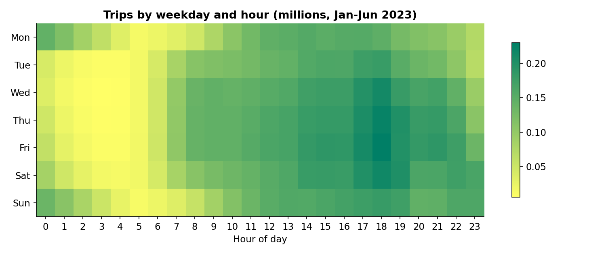

# NYC Taxi Demand Analytics (19.5M trips)

Six months of real NYC yellow-taxi trip records: demand patterns, fare and
tipping economics, statistical tests, and an hourly demand forecast, built on
a Power BI-ready star schema with advanced SQL. Real data at real scale: 19,493,620 trips,
Jan-Jun 2023.

## The business question

Where and when does taxi demand actually happen in New York, what does a
trip earn, what moves tipping - and can next month's demand at the busiest
zone be forecast well enough to plan driver supply?

## Headline findings

- **19.49M trips and $546.8M in fares** across Jan-Jun 2023; revenue climbed
  from $82.9M (Jan) to $101.8M (May) while trip counts stayed flat - trips
  got longer (3.85 to 4.37 avg miles) and slower (15.7 to 18.1 avg minutes).
- **Demand peaks Friday at 18:00**; the weekday x hour matrix shows the
  commuting spine of the city.
- **JFK Airport is the single busiest pickup zone** (993,503 trips, $78.13
  avg fare); 82% of all trips start and end inside Manhattan.
- **Revenue is concentrated:** the top 10 of 265 zones hold 46.8% of revenue,
  the top 50 hold 96.2%.
- **Card tips average 24.7% of the fare** (median 25.9%). Cash tips are not
  recorded at all (0.0% - a recording artifact, not generosity data).
- **Short trips tip best:** 30.4% average under 1 mile, falling to ~21% for
  1-3 mile trips.
- **Rush hour lifts tips:** +1.1 percentage points (p < 0.001, robust OLS,
  n = 300k). Trip distance itself does not move tip %.
- **Forecast:** hourly JFK pickups, June 2023 held out - SARIMAX MAPE 23.8%
  beats the 7-day seasonal-naive baseline (28.4%).

Full write-up with limitations: [docs/findings_and_recommendations.md](docs/findings_and_recommendations.md)

## Repository layout

    sql/01_star_schema.sql    DuckDB: builds fact_trips + 4 dimension tables
    sql/02_core_analysis.sql  10 analyses: window fns, exact percentiles, pivots,
                              moving averages, growth ranks, concentration
    notebooks/taxi_analysis.py  full pipeline: 12 validation checks -> schema ->
                              metrics -> statistical tests -> forecast -> charts
    docs/powerbi/             Power BI-ready model: star schema guide + DAX measures
    docs/review/              data dictionary, validation + SQL run logs
    visuals/                  6 charts generated by the pipeline
    data-exports/             aggregated CSVs (safe for Power BI import)

## How to run

1. Download the data (exact links and expected sizes in
   [data/README.md](data/README.md)) into `data/`.
2. `pip install -r requirements.txt`
3. `python notebooks/taxi_analysis.py` - 12 validation checks run first and
   stop the pipeline on failure.
4. SQL: run `sql/01_star_schema.sql` then `sql/02_core_analysis.sql` in
   DuckDB 1.5 (captured output in docs/review/sql_results.txt).

## Data source and terms

Dataset: **TLC Trip Record Data (yellow taxi), Jan-Jun 2023**, published by
the [NYC Taxi & Limousine Commission](https://www.nyc.gov/site/tlc/about/tlc-trip-record-data.page).
NYC public data under the city's open-data program (Local Law 11 of 2012:
no registration, license or usage restrictions). Attribution: NYC TLC.
The TLC states the records were collected by authorized vendors and that it
"makes no representations as to the accuracy of these data"; quality quirks
are measured and documented, not cleaned away.

All SQL actually executed in **DuckDB 1.5** on the real files; every number
above is reproducible from this repository.
